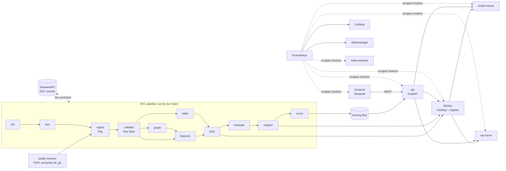

# High-level design

pypirisk predicts the probability that a PyPI package is abandoned in the next 18 months, shows the top factors behind the score, and grades whole projects through the dependency graph. The endpoints are in [LLD.md](LLD.md).

## Architecture

Every block is a container. Blocks talk only over REST, with URLs from environment variables.

| Block | Role |
| --- | --- |
| lint, test | CI checks (ruff, pytest); a failure stops the pipeline before any data work |
| ingest | crawls the sources with Ray tasks; one Ray actor enforces each API's rate limit; responses are cached |
| validate | checks rows with Ray Data, drops invalid ones, fails above 10% invalid |
| graph | dependency graph at each snapshot: dependents, PageRank, k-core |
| features, label | 11 features from the 12 months before a snapshot; the label from the 18 months after |
| train, evaluate | fits the candidates, picks one, calibrates it, logs everything to MLflow; scores the test snapshot |
| register | promotion gate, then a post-deploy check with automatic rollback |
| score | batch-scores every package and writes the serving files |
| MLflow | experiment tracking and model registry |
| model-server, ray-serve | serve `@champion` over `/invocations` (two serving paths) |
| api | FastAPI backend used by the frontend |
| frontend | Streamlit: Package Lookup, Project Scan, Ecosystem Watch, Pipeline Console |
| SeaweedFS | local S3 store, the DVC remote |
| Prometheus, Alertmanager, Grafana, node-exporter | metrics, alerts, dashboard, host metrics |

## Code structure

Object-oriented services (`ResponseCache`, `RateLimiter`, `ServingStore`, `RegistryClient`, `RiskModel`) and functional pipeline stages: each stage is a pure function from tables to tables with a thin CLI (`python -m pypirisk.<stage>`). Pure stages make the leakage tests possible.

## Label

- A package is eligible at a snapshot if it released in the past 12 months and its repository was not archived.
- It is abandoned (label 1) if, in the next 18 months, its repository was archived, or it made no release and at most 2 human commits.
- Snapshots: train 2018 to 2021, validation 2023, test 2025, scoring 2026-11. Each outcome window ends before the next split's snapshot.

## Data

| Source | Used for | Access |
| --- | --- | --- |
| top-pypi-packages | the package universe (top 500 or 5,000 plus dependencies) | public |
| PyPI JSON API | releases and dependencies | public, 10 requests/s |
| git clones (commits only) | commit history | public, no rate limit |
| ecosyste.ms | archive status, issues, missing repository links | public, 5,000 requests/hour |
| GitHub GraphQL | exact archive dates | needs `GITHUB_TOKEN`, optional |

Known biases: the universe is today's popular packages (survivorship bias); packages without a repository link have no commit data; packages sharing a repository share its activity; finished, stable packages can look abandoned.

## Design choices

| Decision | Choice | Why | Alternative |
| --- | --- | --- | --- |
| Data engineering | Ray tasks and one rate-limit actor | I/O-bound crawl with per-host limits | Spark |
| Fixture | 50 real packages replayed from the cache | CI runs the real code path | synthetic data |
| DVC remote | SeaweedFS (local S3) | no cloud; MinIO no longer publishes images | a plain directory |
| MLflow store | SQLite in a volume | enough for one team | Postgres |
| MLproject | `docker_env` with the pipeline image | same environment everywhere | conda environment |
| Deployment | registry alias `@champion` | rollback is one alias move | registry stages |
| Model server | MLflow scoring app plus `/metrics` | must be monitored | plain `mlflow models serve` |
| Second serving path | Ray Serve | Ray is already in the stack | KServe on Minikube |
| Serving data | files written by `score` | enough at this scale | a database |
| Frontend | Streamlit | multi-page UI in Python | a JavaScript app |
| Models | logistic regression and LightGBM, best validation PR-AUC | simple baselines | larger models |
| Promotion gate | beat the heuristic, not worse than the champion by 0.02 | never serve a worse model | manual promotion |
| Rollback | post-deploy check moves the alias back on failure | automatic | manual only |
| Drift | mean shift in reference standard deviations, alert at 1.0 | easy to explain | PSI, KS test |
